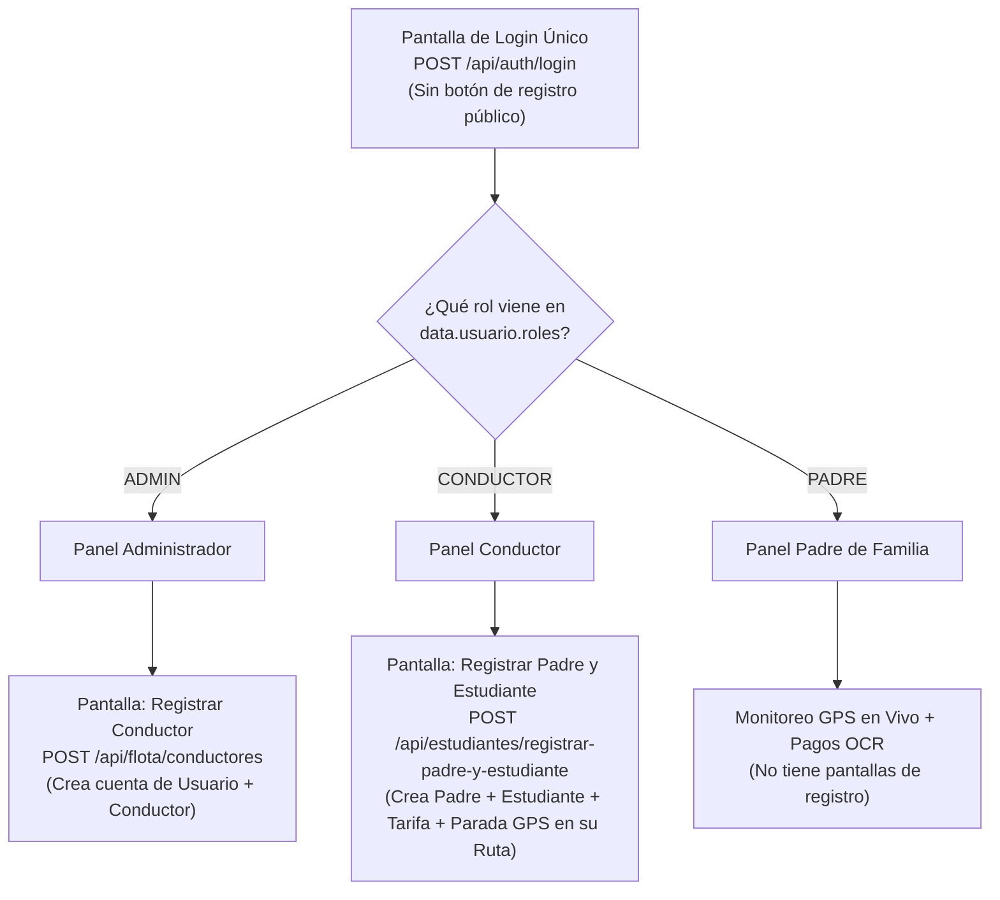

# Guía de Implementación en Frontend (Flutter): Flujo de Registro Jerárquico por Roles

Este documento detalla el cambio de arquitectura en el flujo de registro de usuarios para implementarlo en la aplicación **Flutter**:

> **Regla de Negocio Principal:**
> 1. **No existe botón de "Registrarse" público en la pantalla de Login.** En la pantalla inicial únicamente existe el formulario de **Iniciar Sesión (`POST /api/auth/login`)**.
> 2. **El `ADMIN` registra al `CONDUCTOR`** (y también a los Socios y Buses).
> 3. **El `CONDUCTOR` registra al `PADRE DE FAMILIA` y al `ESTUDIANTE`** (asignándolo automáticamente a su ruta y creando su parada GPS).
> 4. **El `PADRE DE FAMILIA`** únicamente inicia sesión con las credenciales que le creó el Conductor (correo o cédula + contraseña) para monitorear el recorrido GPS de su hijo y subir comprobantes de pago.

---

## 1. Diagrama del Flujo en las Pantallas del Frontend



---

## 2. Cambio 1 en Frontend: Pantalla de Login (`lib/screens/login_screen.dart`)

- **Quitar** cualquier enlace o botón de *"¿No tienes cuenta? Regístrate aquí"*.
- El usuario ingresa su **`identificador`** (puede ser su **correo electrónico** o su **número de cédula**) y su **`password`**.
- Al recibir `"COD": "COD_OK"`, lees `data['usuario']['roles']` y rediriges según el rol:
  - Si contiene `"ADMIN"` $\rightarrow$ `AdminHomeScreen`
  - Si contiene `"CONDUCTOR"` $\rightarrow$ `ConductorHomeScreen`
  - Si contiene `"PADRE"` $\rightarrow$ `PadreHomeScreen`

### Ítems del Menú que devuelve el Backend al Conductor (`data.menu`):
Ahora cuando un `CONDUCTOR` inicia sesión, el Backend le incluye automáticamente este ítem en `data.menu`:
```json
{
  "codigo": "CONDUCTOR_REGISTRO_PADRE_ESTUDIANTE",
  "titulo": "Registrar Padre y Estudiante",
  "ruta": "/conductor/registrar-estudiante",
  "icono": "UserPlus",
  "roles_permitidos": ["CONDUCTOR"]
}
```

---

## 3. Cambio 2 en Frontend: Pantalla del `ADMIN` para Registrar al `CONDUCTOR`

### Endpoint que debe consumir el Administrador
- **Método y URL:** `POST /api/flota/conductores`
- **Cabecera requerida:** `Authorization: Bearer <TOKEN_DEL_ADMIN>`
- **Rol permitido en el Token:** Exclusivamente `ADMIN` (si un Conductor o Padre intenta llamarlo, el Backend responde `403 Forbidden` con `"COD": "COD_ERROR"`).

### JSON que debe enviar el formulario del Administrador:
```json
{
  "email": "conductor.nuevo@cooperativa.ec",
  "password": "conductor123",
  "nombre": "Luis",
  "apellido": "Paredes",
  "cedula": "1712345678",
  "telefono": "0987654321",
  "licencia": "TIPO-E-1712345678"
}
```

### Respuesta Exitosa del Backend (`201 Created`):
```json
{
  "COD": "COD_OK",
  "codigo": 201,
  "mensaje": "Operación realizada exitosamente",
  "data": {
    "id": 2,
    "usuario_id": 6,
    "licencia": "TIPO-E-1712345678",
    "activo": 1,
    "nombre": "Luis",
    "apellido": "Paredes",
    "cedula": "1712345678",
    "email": "conductor.nuevo@cooperativa.ec",
    "telefono": "0987654321"
  }
}
```

---

## 4. Cambio 3 en Frontend: Pantalla del `CONDUCTOR` para Registrar al `PADRE` y al `ESTUDIANTE`

El Conductor tiene dos formas de hacerlo desde la App (se recomienda la **Opción A** porque resuelve todo en un solo formulario):

### Opción A (Recomendada): Registro Todo-en-Uno en un solo formulario
- **Método y URL:** `POST /api/estudiantes/registrar-padre-y-estudiante`
- **Cabecera requerida:** `Authorization: Bearer <TOKEN_DEL_CONDUCTOR>`
- **¿Qué hace automáticamente el Backend?**
  1. Crea el usuario del **Padre de Familia** con rol `PADRE` (y si la cédula o correo del padre ya existe porque tiene otro hijo en la ruta, reutiliza ese mismo padre sin dar error).
  2. Crea al **Estudiante** vinculado a ese Padre.
  3. Registra la **Tarifa mensual** del estudiante (`monto_mensual_inicial`).
  4. Toma la coordenada GPS del domicilio (`domicilio_geom`), crea automáticamente la **Parada (`paradas`)** en la ruta activa de ese Conductor y **asigna al estudiante a la ruta del Conductor**.

#### JSON que debe enviar el formulario del Conductor:
```json
{
  "padre": {
    "email": "roberto.vega@correo.ec",
    "password": "padre123",
    "nombre": "Roberto",
    "apellido": "Vega",
    "cedula": "1723998877",
    "telefono": "0998877665"
  },
  "estudiante": {
    "cedula": "1750998877",
    "nombre": "Mateo",
    "apellido": "Vega",
    "grado": "6to EGB",
    "domicilio_geom": {
      "lat": -0.179500,
      "lng": -78.482100
    },
    "domicilio_direccion": "Av. República del Salvador y Moscú",
    "monto_mensual_inicial": 55.00
  }
}
```

#### Respuesta Exitosa del Backend (`201 Created`):
```json
{
  "COD": "COD_OK",
  "codigo": 201,
  "mensaje": "Operación realizada exitosamente",
  "data": {
    "padre": {
      "id": 7,
      "email": "roberto.vega@correo.ec",
      "nombre": "Roberto",
      "apellido": "Vega",
      "cedula": "1723998877",
      "telefono": "0998877665",
      "activo": 1,
      "total_representados": 1
    },
    "estudiante": {
      "id": 4,
      "representante_usuario_id": 7,
      "representante_nombre": "Roberto Vega",
      "representante_cedula": "1723998877",
      "representante_telefono": "0998877665",
      "representante_email": "roberto.vega@correo.ec",
      "cedula": "1750998877",
      "nombre": "Mateo",
      "apellido": "Vega",
      "grado": "6to EGB",
      "activo": 1,
      "domicilio_geom": {
        "lat": -0.1795,
        "lng": -78.4821
      },
      "domicilio_direccion": "Av. República del Salvador y Moscú",
      "tarifa_actual": 55.0,
      "asignaciones_activas": [
        {
          "id": 4,
          "estudiante_id": 4,
          "ruta_id": 1,
          "ruta_nombre": "Ruta Norte - La Carolina",
          "parada_id": 5,
          "parada_nombre": "Av. República del Salvador y Moscú",
          "parada_orden": 5,
          "activa": 1
        }
      ]
    }
  }
}
```

### Opción B: Registro por separado (si tienes 2 pantallas separadas)
El `CONDUCTOR` también tiene permisos en su Token para llamar por separado a:
1. `GET /api/estudiantes/padres` (para buscar si el padre ya existe).
2. `POST /api/estudiantes/padres` (para crear solo al padre).
3. `POST /api/estudiantes` (para crear al estudiante vinculado con `representante_usuario_id`; si lo llama el Conductor con `domicilio_geom`, también lo asigna automáticamente a su ruta).

---

## 5. Código Dart / Flutter Listo para Copiar (`lib/services/registro_jerarquico_service.dart`)

```dart
import 'package:dio/dio.dart';
import '../core/api_client.dart';

class RegistroJerarquicoService {
  /// 1. EXCLUSIVO ADMIN: Registrar un nuevo Conductor
  Future<Map<String, dynamic>> registrarConductorPorAdmin({
    required String email,
    required String password,
    required String nombre,
    required String apellido,
    required String cedula,
    required String telefono,
    required String licencia,
  }) async {
    try {
      final response = await ApiClient.dio.post(
        '/flota/conductores',
        data: {
          'email': email.trim(),
          'password': password,
          'nombre': nombre.trim(),
          'apellido': apellido.trim(),
          'cedula': cedula.trim(),
          'telefono': telefono.trim(),
          'licencia': licencia.trim(),
        },
      );

      final body = response.data as Map<String, dynamic>;
      if (body['COD'] != 'COD_OK') {
        throw Exception(body['mensaje'] ?? 'Error al registrar al conductor');
      }
      return body['data'] as Map<String, dynamic>;
    } on DioException catch (e) {
      final msg = e.response?.data?['mensaje'] ?? 'Error al registrar conductor';
      throw Exception(msg);
    }
  }

  /// 2. CONDUCTOR (o ADMIN): Registrar al Padre de Familia + Estudiante + Parada GPS en su ruta
  Future<Map<String, dynamic>> registrarPadreYEstudiantePorConductor({
    required String padreEmail,
    required String padrePassword,
    required String padreNombre,
    required String padreApellido,
    required String padreCedula,
    required String padreTelefono,
    required String estudianteCedula,
    required String estudianteNombre,
    required String estudianteApellido,
    required String estudianteGrado,
    required double latitudCasa,
    required double longitudCasa,
    required String direccionCasa,
    required double montoMensual,
    int? rutaId,
  }) async {
    try {
      final response = await ApiClient.dio.post(
        '/estudiantes/registrar-padre-y-estudiante',
        data: {
          'padre': {
            'email': padreEmail.trim(),
            'password': padrePassword,
            'nombre': padreNombre.trim(),
            'apellido': padreApellido.trim(),
            'cedula': padreCedula.trim(),
            'telefono': padreTelefono.trim(),
          },
          'estudiante': {
            'cedula': estudianteCedula.trim(),
            'nombre': estudianteNombre.trim(),
            'apellido': estudianteApellido.trim(),
            'grado': estudianteGrado.trim(),
            'domicilio_geom': {
              'lat': latitudCasa,
              'lng': longitudCasa,
            },
            'domicilio_direccion': direccionCasa.trim(),
            'monto_mensual_inicial': montoMensual,
          },
          if (rutaId != null) 'ruta_id': rutaId,
        },
      );

      final body = response.data as Map<String, dynamic>;
      if (body['COD'] != 'COD_OK') {
        throw Exception(body['mensaje'] ?? 'Error al registrar padre y estudiante');
      }
      return body['data'] as Map<String, dynamic>;
    } on DioException catch (e) {
      final msg = e.response?.data?['mensaje'] ?? 'Error al registrar padre y estudiante';
      throw Exception(msg);
    }
  }
}
```

---

## 6. Resumen de Permisos en el Backend (`app/core/deps.py`)

| Ruta del Backend | Método | `ADMIN` | `CONDUCTOR` | `PADRE` |
| :--- | :---: | :---: | :---: | :---: |
| `/api/auth/login` | `POST` | Sí | Sí | Sí |
| `/api/flota/conductores` | `POST / PUT / PATCH` | **Sí** | Bloqueado (`403`) | Bloqueado (`403`) |
| `/api/estudiantes/registrar-padre-y-estudiante` | `POST` | **Sí** | **Sí** | Bloqueado (`403`) |
| `/api/estudiantes/padres` | `GET / POST` | **Sí** | **Sí** | Bloqueado (`403`) |
| `/api/estudiantes` | `POST / PUT / PATCH` | **Sí** | **Sí** | Bloqueado (`403`) |
| `/api/estudiantes` | `GET` | Todos | Solo su ruta | Solo sus hijos |
| `/api/rutas/{id}/paradas` | `POST / PUT` | **Sí** | **Sí** | Bloqueado (`403`) |

